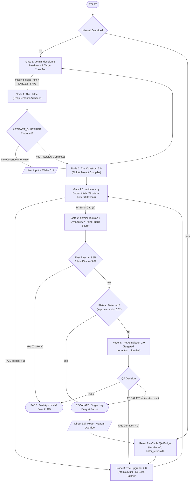

# 🧠 BetterBot 2.0 — Hybrid Agent & Skill Compiler

An autonomous, two-stage Multi-Agent System for prompt engineering, AI agent design, and production-grade **Agent Skills** compilation, built on **LangGraph**, **FastAPI**, a dual-engine persistence layer (**Neon PostgreSQL + SQLite fallback** in `storage.py`), a **Vite + React + TypeScript** UI (`frontend/`), and tiered hybrid integration of **Google Gemini** models (`gemini-4-neon`, `gemini-4-hydrogen`, and `gemini-decision-1`).

The system features the **Obsidian & Neural Glass Studio (v3.6)** interface with **Light / Dark Mode** (persistent toggle with dual-theme Shiki syntax highlighting and FOUC prevention), live SSE streaming, configurable **Effort Tiers (`low` / `medium` / `high` / `overkill`)** with server-side **Master Mode** locks, **Multimodal Context Uploads** (Ingest-Once Distillation for PDFs, images, and code/text), **Adversarial Red-Team & Harden (`⚔️ Red-Team`)**, workspace isolation, **Workspace Sync (`Master Mode`)** + one-click JSON import/export, a persistent creation history drawer, a hierarchical multi-file artifact studio (`SKILL.md`, `AGENTS.md`, `references/*`, Python stdlib helper scripts under `scripts/*.py`, `skills/<sub_slug>/SKILL.md`, and `.ZIP` export including `BETTERBOT_INSTALL.md`), a readiness meter and dynamic 6–9D rubric scorecard (`gemini-decision-1`), and **Betty** — a docked/floating real-time architecture advisor aware of `SKILL_SUITE` topology, attachments, and Red-Team findings.

> [!NOTE]
> **Branch & Live Production Policy:**
> The `main` branch is reserved as the stable production release connected to the live **Render** deployment. All active development, improvements, and new versions are managed and pushed exclusively on `develop`, and merged into `main` only after stabilization and thorough verification to ensure high availability of the live site.

---

## 🎯 Purpose & 4 Compilation Targets

Modern models with native reasoning no longer need bloated prompts cluttered with explicit thinking tags. Instead of generating a monolithic "wall of text," **BetterBot 2.0** compiles free-form requirements into one of four dedicated compilation targets under an `<ARTIFACT_BLUEPRINT>`:

1. **`SKILL_PACKAGE` (`SKILL.md` + `references/*` + optional `scripts/*.py`):**
   * Produces a modular `SKILL.md` with precise **YAML Frontmatter** (`name`, `description` including positive and negative triggers) and a concise Standard Operating Procedure (SOP).
   * Enforces **Progressive Disclosure**: heavy templates, schemas, and examples are automatically separated into auxiliary files under `references/<filename>.md`, and deterministic mechanical tasks (`needs_scripts=True`) are offloaded to standalone **Python 3 stdlib-only** CLI scripts under `scripts/<name>.py`.
2. **`SYSTEM_PROMPT` (Constitutional System Prompt / `AGENTS.md`):**
   * Produces a token-dense constitutional system prompt driven by Affirmative Actionability without unnecessary visible CoT tags, backed by a silent internal `<VERIFICATION_RUBRIC>`. In **`is_repo_context=True`** mode (an operational contract for repository coding agents), the output is exported directly as a repo-focused **`AGENTS.md`** (Git/Branch Guardrails, Directory-as-Router table, invariants, and verification protocol) without adding a 5th target type and without `scripts/*.py`.
3. **`HYBRID_BUNDLE` (`SYSTEM_PROMPT.md` / `AGENTS.md` + `SKILL.md` + `references/*` + optional `scripts/*.py`):**
   * Produces a combined package containing both a core constitutional identity (or `AGENTS.md` in repo mode) and a separate modular skill with auxiliary files/scripts, packaged for direct download as a `.zip` archive under `<slug_name>/` alongside `BETTERBOT_INSTALL.md`.
4. **`SKILL_SUITE` (`skills/<sub_slug>/SKILL.md` + `skills/<sub_slug>/references/*` + optional `skills/<sub_slug>/scripts/*.py`):**
   * Compiles a multi-skill suite of 2–4 independently installable atomic skills (Pick & Mix) in a nested directory tree under `skills/<sub_slug>/...`, with hierarchical `.zip` export under `<slug_name>/` and `BETTERBOT_INSTALL.md`.
   * Governed by the **Orthogonality Rule** in Gate 1: the system defaults to a single skill (`SKILL_PACKAGE` or `HYBRID_BUNDLE` + `references/*`) for tightly coupled workflows, and activates `SKILL_SUITE` only for 2–4 distinct domains while enforcing mutual negative triggers in each sibling skill's `description` to prevent trigger collisions.

---

## 💡 Hybrid Architecture & Decision Engine (`gemini-decision-1`)

The system is built as a cyclic **StateGraph** in LangGraph (`resolve_next_node` as the single transition source of truth shared by CLI and `server.py`), combining a **single-pass decision model (`gemini-decision-1` — 0 output tokens)** as two quantitative control gates (**Gate 1 & Gate 2**) alongside lazy, timeout-guarded tiered routing between **`gemini-4-neon`** (compilation, atomic upgrading, and quality adjudication) and **`gemini-4-hydrogen`** (interviewing, Betty, and fallback):

### System Flow Diagram (BetterBot 2.0)



### Hybrid Engine Gates & Four Agents

1. **Gate 1 — Interview Readiness & Orthogonality Rule (`gemini-decision-1` + `HELPER_READINESS_QUESTIONS`):**
   * Evaluates 8 fields on every conversation turn (`target_type` from 4 valid values: `SKILL_PACKAGE`, `SYSTEM_PROMPT`, `HYBRID_BUNDLE`, `SKILL_SUITE`; plus `has_core_objective`, `has_trigger_or_context`, `has_output_contract`, `needs_auxiliary_files`, `needs_scripts`, `is_repo_context`, `ready_to_compile`), enforces the **Orthogonality Rule** to prevent over-splitting tightly coupled workflows, and injects a targeted `missing_fields_hint` into the Helper.
   * Communicates over a persistent `requests.Session()` using the `x-goog-api-key` header (never URL query parameters) with a 5-second timeout and defensive API-key redaction (`_sanitize_error_text`) in fallback logs.
2. **Node 1 — The Helper (`The Requirements Architect`):**
   * Interviews the user (up to 3 turns) using **Inference over Interrogation**, receives conversation history strictly via a single `("human", "{user_input}")` message (never duplicated inside `prompts/helper.md`), focuses `is_repo_context=True` sessions on repository topology and verification constraints rather than a chatbot persona, and produces an `<ARTIFACT_BLUEPRINT>` containing `<META>`, `<IDENTITY_AND_STANCE>`, `<ROUTING_AND_TRIGGERS>`, `<EXECUTION_ARCHITECTURE>`, and `<OUTPUT_CONTRACT>` (with full backward compatibility for `<GEM_BLUEPRINT>`). When `target_type == "SKILL_SUITE"`, the blueprint also includes `<SUITE_TOPOLOGY>` defining 2–4 atomic skills (`slug`, `single_responsibility`, `positive_triggers`, and `negative_triggers_vs_siblings`).
3. **Node 2 — The Construct 2.0 (`The Hybrid Compiler`):**
   * Powered by `COMPILER_MODEL` (`gemini-4-neon` with automatic fallback to `FALLBACK_MODEL` / `gemini-4-hydrogen`, fast-failing on non-retryable 401/403 auth errors), using `thinking_level="medium"` for multi-file packages (`SKILL_PACKAGE` / `HYBRID_BUNDLE` / `SKILL_SUITE` / `references/` / `scripts/`) and `thinking_level="low"` for lightweight `SYSTEM_PROMPT` targets. Splits nested `### FILE: <path>` blocks (such as `references/...`, `scripts/<name>.py`, `AGENTS.md`, `skills/<sub_slug>/SKILL.md`, `skills/<sub_slug>/references/<file>.md`, and `skills/<sub_slug>/scripts/<name>.py`) through strict single-source path sanitization (`validators.normalize_artifact_path`) and defensive stripping of outer Markdown code fences from `.py` files (`_strip_python_code_fence`) into the unified `state["reference_files"]` map.
4. **Gate 1.5 — Deterministic Structural Linter (`validators.py` — `gate_1_5_linter`, 0 tokens):**
   * Runs automatically after `The Construct 2.0` and `The Upgrader 2.0` and before Gate 2 (`gemini-decision-1`) to catch objective structural failures with zero LLM calls: YAML Frontmatter validity (`name`, `description`), deterministic Python syntax (`ast.parse()`) plus static AST security & CLI hygiene checks on all `scripts/*.py` (`skills/<sub_slug>/scripts/*.py`) — rejecting `eval`, `exec`, `os.system`, and `subprocess.*(..., shell=True)` while enforcing CLI argument reading (`argparse`/`sys.argv`) and error exit codes — prohibition of scripts in `SYSTEM_PROMPT`, broken `references/*` / `scripts/*` links or orphan files (including relative path resolution under `skills/<sub_slug>/...` in `SKILL_SUITE`), 2–4 skill topology in `SKILL_SUITE`, `AGENTS.md` entry-point recognition, and path safety (`normalize_artifact_path`). Capped at `MAX_LINTER_RETRIES = 1` via `linter_retries` without consuming the Gate 2 QA budget (`MAX_QA_ITERATIONS = 2`).
5. **Gate 2 & Node 4 — The Adjudicator 2.0 (`gemini-decision-1` + `get_rubric_questions`):**
   * **Stage A (Dynamic Quantitative Scoring via `v1beta/decisions` in ~500ms):** Driven by `get_rubric_questions(target_type, needs_scripts)` — preserves the 6 base dimensions (`intent_alignment`, `token_density_no_bloat`, `trigger_precision`, `progressive_disclosure`, `actionable_clarity`, and `output_contract_strength`) for `SYSTEM_PROMPT`, appends `operational_resilience` for `SKILL_PACKAGE` / `HYBRID_BUNDLE` / `SKILL_SUITE`, appends `script_rigor_and_parity` when `needs_scripts=True` (or `.py` files exist), and dynamically appends `trigger_deconfliction` (0–5) for `SKILL_SUITE` only.
   * **Stage B (Tiered Fast Pass / Script Gate / Single-Entry Escalation):** Enforces `effort_tier`-calibrated Fast-Pass gates (`low`/`medium`: `>= 0.82`, `min_dim >= 3.0`; `high`: `>= 0.88`, `min_dim >= 3.5`; `overkill`: Fast Pass disabled, always runs Stage B), plus `script_rigor_and_parity >= 4.0` whenever scripts are scored (routing below `4.0` to Stage B for adversarial mental edge-case execution); guards against monoliths with a deterministic cap (`progressive_disclosure <= 2.0` + `FAIL` when `references/*` are required but missing); halts cleanly on plateau detection (`< 0.02` improvement), or generates a targeted `correction_directive` via `ADJUDICATOR_MODEL`. When a `[FAIL]` hits `MAX_QA_ITERATIONS = 2`, `node_adjudicator` emits a single `[ESCALATE] Circuit Breaker triggered...` entry and routes directly to `END` in both Web SSE and CLI (`run_factory`).
6. **Node 3 — The Upgrader 2.0 (`Atomic Delta-Patcher`):**
   * Powered by `UPGRADER_MODEL` (`gemini-4-neon`, `thinking_level="medium"`, falling back to `gemini-4-hydrogen`) and operates via **Delta-Patching** instead of full rewrites: snapshots `previous_artifact_snapshot` before patching (powering multi-file and post-`PASS` diffs in `QaView`), emits only added/modified `### FILE: <path>` blocks (including `scripts/*.py` and `AGENTS.md`) and optional `### DELETE: <path>` directives, merges changes into `state["reference_files"]` while leaving untouched files intact, and atomically synchronizes `<ARTIFACT_BLUEPRINT>` and core files following a QA failure or `[MANUAL OVERRIDE]` command. Every `[MANUAL OVERRIDE]` turn resets the per-cycle QA budget (`iteration_count = 0`, `linter_retries = 0`, and plateau baseline) while preserving `error_log` and timeline history so remediation loops have a full `MAX_QA_ITERATIONS = 2` budget.
7. **Adversarial Red-Team & Harden (`⚔️ Red-Team` + `overkill` Auto-Harden):**
   * An independent zero-bias critic (`prompts/red_team.md`) that inspects only the compiled artifact(s) and concise goal summary (`invoke_red_team`), stress-testing `scripts/*.py` edge cases, $O(N)$ scaling, operational/rollback safety, and Net-LOC discipline.
   * Available on demand via read-only `POST /api/sessions/{id}/red-team` (`10/60s` rate limit) with one-click **Harden Package (Delta-Patch)** in `RedTeamPanel`, and runs automatically once per compilation cycle after `[PASS]` under `effort_tier="overkill"` (`node_red_team_auto` capped by `red_team_auto_ran`).
8. **Multimodal Context Uploads (Ingest-Once Distillation — `prompts/attachment_digest.md`):**
   * Supports up to `4` attachments per session (`<= 10 MB` each, bounded read, PDF/PNG/JPEG/WebP magic-byte & UTF-8 NUL-byte validation) via `POST/DELETE /api/sessions/{id}/attachments`. Small UTF-8 text/code (`<= 4096` bytes) is stored verbatim (`0` tokens); larger text/code, images, and PDFs are distilled once via `FAST_MODEL` (`thinking_level="low"`) into a compact `Context Digest` (raw bytes/Base64 discarded immediately) and injected as `<ATTACHED_CONTEXT>` across all agents and Betty.

---

## 🖥️ Studio UI, Hardening, Dual-Engine Persistence & Export (v3.6)

* **Dual-Engine Persistent Storage — Neon PostgreSQL + SQLite Fallback ([storage.py](storage.py)):**
  * Built-in support for **Neon PostgreSQL** in production (`DATABASE_URL` via `psycopg` v3 with a thread-safe bounded LIFO connection pool: `_PG_POOL_MAXSIZE = 6`, `120s` idle TTL) with zero-config fallback to local **SQLite** (`betterbot_history.db`, WAL mode + `PRAGMA busy_timeout = 5000`) through the unified `_ConnAdapter`.
  * Features atomic single-query upserts (`_upsert_session_row`), SQL JSON metadata projection in `list_sessions` (`json_extract` / `state_json::jsonb`), sanitized hydration of nested `reference_files` paths and `needs_scripts` / `is_repo_context` flags, idempotent migrations scoped by `owner_id`, explicit warning diagnostics, and automatic restoration from `betterbot_sessions_snapshot.json` if present.
  * The active session and last workspace view are automatically restored on page refresh via `localStorage`.
* **Multi-Tenant Workspace Isolation, Runtime Hardening & JSON Portability ([server.py](server.py)):**
  * Each browser is isolated under a UUID (`betterbot_workspace_id`) via `X-Workspace-ID`, segregating data by `owner_id` in PostgreSQL/SQLite, bounded `OrderedDict` LRU caches (`MAX_CACHED_SESSIONS = 256`, `MAX_BETTY_WORKSPACES = 256`, `80` messages per Betty mode), and Betty's history.
  * Per-session `asyncio.Lock` guards prevent concurrent `/stream` executions (`409 Conflict`), worker nodes run against isolated `copy.deepcopy(state)` snapshots with `asyncio.to_thread` offloading for all blocking DB/file I/O, and `CancelledError` cleanup prevents sessions from getting stuck in `compiling`.
  * Enforces origin-restricted `CORSMiddleware` (`ALLOWED_ORIGINS`), sliding-window `_RateLimiter` throttling (`verify-master` `10/60s`, `stream` `20/60s`, `betty` `30/60s` -> `429`), and bounded workspace import limits (`10 MB` -> `413`, `200` sessions -> `400`).
  * The **"Workspace Sync"** modal (`WorkspaceSyncModal`) and optional **`Master Mode`** (`MASTER_WORKSPACE_KEY` verified in constant time via `hmac.compare_digest` on `X-Master-Key` at `POST /api/workspace/verify-master`) plus one-click **JSON Export / Import** (`GET /api/workspace/export`, `POST /api/workspace/import`) enable cross-browser portability with ID remapping on collisions.
* **Thinking Budget Calibration, Tiered Routing & Fallback ([main.py](main.py)):**
  * `FAST_MODEL` (`gemini-4-hydrogen`, `thinking_level="low"`): powers `The Helper`, `Betty`, and serves as `FALLBACK_MODEL`.
  * `COMPILER_MODEL` (`gemini-4-neon`): powers `The Construct 2.0` (`thinking_level="medium"` for `SKILL_PACKAGE`, `HYBRID_BUNDLE`, `SKILL_SUITE`, `references/`, or `scripts/`, and `low` for lightweight `SYSTEM_PROMPT`), `The Upgrader 2.0` (`thinking_level="medium"`), and Stage B of `The Adjudicator 2.0` (`thinking_level="low"`).
  * Lazy cached Gemini clients (`_get_chat_model`) enforce `LLM_TIMEOUT_SECONDS` (`90s`) and `LLM_MAX_RETRIES` (`1`), fast-failing on non-retryable 401/403 authentication errors; `v1beta/decisions` (`gemini-decision-1`) runs in ~500ms with 0 output tokens and a 5-second hard timeout.
* **Frontend Studio, Code-Splitting & Linting ([frontend/](frontend/)):**
  * Built in **React 19 + TypeScript + Vite** (`0` warnings / `0` errors under `oxlint` and `tsc -b`), featuring persistent **Light / Dark Mode** (`localStorage` + `prefers-color-scheme` + FOUC guard), synchronized with `Gate 1.5 Linter` live telemetry/status and the `MAX_QA_ITERATIONS = 2` (`X/2`) Circuit Breaker meter.
  * **Shiki** syntax highlighting (`core`, JS regex engine, dual `github-light` / `github-dark` themes, and 10 language grammars) is dynamically code-split (`import()`) into on-demand async chunks, cutting the main JS entry bundle from `1,607.82 kB` down to `752.10 kB`.
  * Includes **Creation History Drawer** (`HistoryDrawer`), **Hierarchical Artifact Studio & `.ZIP` Export** (`ArtifactsView` with `BETTERBOT_INSTALL.md`, `AGENTS.md`, `references/*`, `scripts/*.py`), **Decision 1 Rubric Scorecard & Multi-File QA Diff** (`QaView` using `diff_champion` / `diff_challenger` even across `SKILL_SUITE` and post-`PASS` upgrades), and **Betty** AI advisor.

---

## 🚀 Installation, Deployment, Verification & Environment Variables

### 1. Local Installation & Startup
```powershell
git clone https://github.com/yubranvalde-byte/betterBot.git
cd betterBot

python -m venv venv
.\venv\Scripts\activate
.\venv\Scripts\pip.exe install -r requirements.txt
.\venv\Scripts\python.exe server.py
```
Once running, open in your browser: 👉 **http://127.0.0.1:8000**

### 2. Verification & Build Checks
Run before committing on `develop`:
```powershell
python scripts/check_invariants.py
.\venv\Scripts\python.exe scripts/check_invariants.py
npm --prefix frontend run lint
npm --prefix frontend run build
```

### 3. Environment Variables (`.env` and `render.yaml`)
| Variable | Default | Description |
| :--- | :--- | :--- |
| `GOOGLE_API_KEY` | *(Required)* | Active Google AI Studio / Gemini API key |
| `FAST_MODEL` | `gemini-4-hydrogen` | Fast model (`thinking_level="low"`) for interviewing (`The Helper`), `Betty`, and Fallback |
| `COMPILER_MODEL` | `gemini-4-neon` | Core model (`The Construct 2.0` at `medium`/`low`, `The Upgrader 2.0` at `medium`, and `The Adjudicator 2.0` at `low` under `medium` tier) |
| `HEAVY_MODEL` | `COMPILER_MODEL` | High-capacity model used by `The Construct 2.0`, `The Upgrader 2.0`, and `Red-Team` under `overkill` tier |
| `FALLBACK_MODEL` | `gemini-4-hydrogen` | Deterministic fallback target when `COMPILER_MODEL` fails or is unavailable |
| `DECISION_MODEL` | `gemini-decision-1` | Single-pass decision engine for interview readiness and QA rubric gates (Gate 1 & Gate 2) |
| `HELPER_MODEL` / `CONSTRUCT_MODEL` / `UPGRADER_MODEL` / `ADJUDICATOR_MODEL` / `RED_TEAM_MODEL` / `BETTY_MODEL` | *(Optional — role defaults)* | Explicit per-agent or per-role model override |
| `LLM_TIMEOUT_SECONDS` / `LLM_MAX_RETRIES` | `90` / `1` | Per-invocation timeout and retry cap for Gemini chat clients |
| `DATABASE_URL` | *(Optional — falls back to SQLite via `DB_PATH`)* | Connection string for **Neon PostgreSQL** in production (via `psycopg` v3 + pooled connections; falls back automatically to SQLite if unset) |
| `DB_PATH` | `betterbot_history.db` | SQLite database file path for local session and history persistence (Fallback) |
| `MASTER_WORKSPACE_KEY` | *(Optional)* | Secret key to enable `Master Mode` and central owner history access on shared/Render deployments (constant-time `hmac.compare_digest` via `X-Master-Key`) |
| `ALLOWED_ORIGINS` | `http://localhost:5173,http://127.0.0.1:5173,http://localhost:8000,http://127.0.0.1:8000` | Comma-separated CORS allow-list for browser origins |
| `MAX_CACHED_SESSIONS` / `MAX_BETTY_WORKSPACES` | `256` / `256` | Bounded in-memory LRU cache limits per workspace store |

---

## 📂 Project Structure

```text
BetterBot/
├── server.py                  # FastAPI server: SSE streaming, per-session asyncio locks, rate limits, CORS, workspace isolation, JSON/ZIP export (AGENTS.md, scripts/*.py, BETTERBOT_INSTALL.md), and Betty routes
├── storage.py                 # Dual-engine persistence scoped by owner_id: pooled Neon PostgreSQL (DATABASE_URL / psycopg v3) + SQLite WAL Fallback, atomic upserts, and SQL JSON listing
├── main.py                    # LangGraph 2.0 engine, resolve_next_node, gemini-decision-1 (Gate 1/2), Gate 1.5, stdlib scripts, AGENTS.md mode, SKILL_SUITE, Delta-Patching, and Manual Override budget reset
├── validators.py              # Zero-token Gate 1.5 deterministic structural linter (YAML frontmatter, ast.parse() on scripts/*.py, references, SKILL_SUITE topology, AGENTS.md) and normalize_artifact_path
├── prompts.py                 # Thin stdlib loader + dynamic rubrics (HELPER_READINESS_QUESTIONS incl. needs_scripts & is_repo_context, get_rubric_questions with trigger_deconfliction)
├── prompts/                   # Externalized per-agent Markdown templates (helper, construct, upgrader, adjudicator_*, red_team, attachment_digest, betty_*)
├── frontend/                  # Studio app in Vite + React + TypeScript + Tailwind (dynamic code-split Shiki, AttachmentBar, EffortTierSelector, RedTeamPanel, 0 oxlint warnings) built directly into static/
├── static/                    # Vite-compiled production bundle (index.html, favicon.svg, assets/*) — do not hand-edit
├── scripts/
│   └── check_invariants.py    # Zero-dependency, zero-LLM architectural verification gate (8 checks: branch, path sanitization, rubrics, files, linter, effort/auth, Red-Team, attachments)
├── AGENTS.md                  # Operational contract, architecture map, and verification rules for coding agents
├── requirements.txt           # Python packages and pinned versions
├── render.yaml                # Render deployment blueprint including model and DB environment variables
├── .gitignore                 # Excludes venv, secrets, and local databases
└── README.md                  # Project documentation
```
