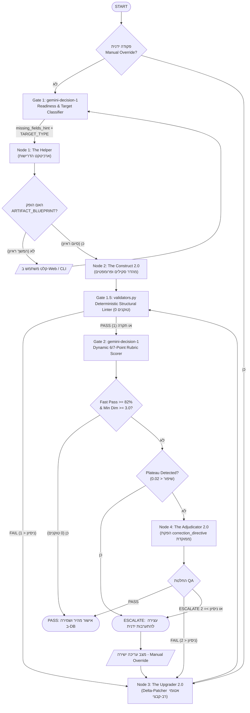

# 🧠 BetterBot 2.0 — Hybrid Agent & Skill Compiler (מפעל הבינה)

מערכת מולטי-סוכנים (Multi-Agent System) אוטונומית ודו-שלבית להנדסת פרומפטים, תכנון סוכני AI והידור חבילות **Agent Skills** ברמת Production, המבוססת על **LangGraph**, **FastAPI**, **SQLite (`storage.py`)**, ואינטגרציה היברידית מדורגת של מודלי **Google Gemini (`gemini-4-neon`, `gemini-4-hydrogen`, ו-`gemini-decision-1`)**.

המערכת כוללת ממשק **Obsidian & Neural Glass Studio (v3.6)** מלא עם שידור חי (SSE), בידוד מרחבי עבודה ו-`Master Mode` + ייבוא/ייצוא JSON, ספריית היסטוריית יצירות מתמידה, מעבדת תוצרים היררכית רב-קובצית (`SKILL.md`, `references/*`, `skills/<sub_slug>/SKILL.md`, וייצוא `.ZIP` הכולל `BETTERBOT_INSTALL.md`), מד מוכנות וניקוד רובריקות דינמי של 6/7 ממדים (`gemini-decision-1`), ואת **בטי (Betty)** — עוזרת ויועצת ארכיטקטורה צפה ומעוגנת בזמן אמת המודעת גם לטופולוגיית `SKILL_SUITE`.

> [!NOTE]
> **מדיניות ענפים וסביבת Live Production:**
> ענף `main` שמור כגרסת הייצור היציבה המחוברת לפריסה החיה ב-**Render** (המקושרת בקורות החיים). כל עבודת הפיתוח השוטפת, השיפורים והגרסאות החדשות מנוהלים ונדחפים לענף `develop` בלבד, ויימזגו ל-`main` רק לאחר ייצוב ובדיקה מקיפה כדי להבטיח זמינות וריצה חלקה של האתר שבאוויר.

---

## 🎯 המטרה ו-4 יעדי ההידור (Purpose & Compilation Targets)

מודלים מתקדמים בעלי חשיבה טבעית (Native Reasoning) כבר אינם זקוקים לפרומפטים עמוסים ומנופחים עם תגיות חשיבה גלויות. במקום לייצר "קיר טקסט" אחיד, **BetterBot 2.0** ממיר דרישה חופשית בעברית לאחד מארבעה יעדי הידור ייעודיים תחת תבנית `<ARTIFACT_BLUEPRINT>`:

1. **`SKILL_PACKAGE` (`SKILL.md` + `references/*`):**
   * מפיק קובץ `SKILL.md` מודולרי עם **YAML Frontmatter** מדויק (`name`, `description` הכולל טריגרים חיוביים ושליליים) ונוהל ביצוע תמציתי (SOP).
   * מיישם **חשיפה הדרגתית (Progressive Disclosure)**: תבניות כבדות, סכמות ודוגמאות מופרדות אוטומטית לקובצי עזר תחת `references/<filename>.md`.
2. **`SYSTEM_PROMPT` (Constitutional System Prompt):**
   * מפיק פרומפט מערכת חוקתי בדחיסות טוקנים גבוהה, מונחה-פעולה (Affirmative Actionability) ונטול תגיות CoT גלויות מיותרות, המגובה ברובריקת אימות פנימית שקטה (`<VERIFICATION_RUBRIC>`).
3. **`HYBRID_BUNDLE` (`SYSTEM_PROMPT.md` + `SKILL.md` + `references/*`):**
   * מפיק חבילה משולבת הכוללת גם זהות ליבה חוקתית וגם סקיל מודולרי נפרד וקובצי עזר, הארוזה להורדה ישירה כארכיון `.zip` תחת `<slug_name>/` בצירוף `BETTERBOT_INSTALL.md`.
4. **`SKILL_SUITE` (`skills/<sub_slug>/SKILL.md` + `skills/<sub_slug>/references/*`):**
   * מהדר חבילה רב-סקילית של 2–4 סקילים אטומיים הניתנים להתקנה עצמאית (Pick & Mix) בעץ תיקיות מקונן תחת `skills/<sub_slug>/...`, עם ייצוא `.zip` היררכי תחת `<slug_name>/` ו-`BETTERBOT_INSTALL.md`.
   * כפוף ל**כלל האורתוגונליות (Orthogonality Rule)** ב-Gate 1: המערכת בוחרת כברירת מחדל בסקיל יחיד (`SKILL_PACKAGE` או `HYBRID_BUNDLE` + `references/*`) עבור תהליך עבודה מצומד, ומפעילה `SKILL_SUITE` רק ל-2–4 דומיינים נפרדים, תוך אכיפת טריגרים שליליים הדדיים ב-`description` של כל סקיל אח למניעת התנגשות טריגרים.

---

## 💡 הארכיטקטורה ההיברידית ומנוע ההחלטות (`gemini-decision-1`)

המערכת בנויה כגרף מצבים ציקלי (**StateGraph** ב-LangGraph) המשלב **מודל החלטות חד-מעברי (`gemini-decision-1` — 0 טוקני פלט)** כשני שערי בקרה כמותיים (**Gate 1 & Gate 2**) לצד ניתוב מודלים מדורג בין **`gemini-4-neon`** (להידור, שדרוג אטומי וביקורת איכות) לבין **`gemini-4-hydrogen`** (לראיון, בטי ו-Fallback):

### תרשים זרימת המערכת (BetterBot 2.0)



### שערי המנוע ההיברידי וארבעת הסוכנים

1. **Gate 1 — בדיקת מוכנות ראיון וכלל האורתוגונליות (`gemini-decision-1` + `HELPER_READINESS_QUESTIONS`):**
   * מעריך בכל תור שיחה 6 ממדים (`target_type` מתוך 4 ערכים חוקיים: `SKILL_PACKAGE`, `SYSTEM_PROMPT`, `HYBRID_BUNDLE`, `SKILL_SUITE`; וכן `has_core_objective`, `has_trigger_or_context`, `has_output_contract`, `needs_auxiliary_files`, `ready_to_compile`), אוכף את **כלל האורתוגונליות (Orthogonality Rule)** למניעת פיצול יתר של תהליכי עבודה מצומדים, ומזריק ל-Helper רמז מדויק (`missing_fields_hint`).
2. **Node 1 — The Helper (`The Requirements Architect`):**
   * מראיין את המשתמש בעברית (עד 3 סבבים) בעקרון **Inference over Interrogation**, ומפיק תבנית `<ARTIFACT_BLUEPRINT>` הכוללת `<META>`, `<IDENTITY_AND_STANCE>`, `<ROUTING_AND_TRIGGERS>`, `<EXECUTION_ARCHITECTURE>` ו-`<OUTPUT_CONTRACT>` (תוך תמיכה מלאה לאחור ב-`<GEM_BLUEPRINT>`). כאשר `target_type == "SKILL_SUITE"`, התבנית כוללת גם `<SUITE_TOPOLOGY>` המגדיר 2–4 סקילים אטומיים (`slug`, `single_responsibility`, `positive_triggers`, ו-`negative_triggers_vs_siblings`).
3. **Node 2 — The Construct 2.0 (`The Hybrid Compiler`):**
   * מופעל על ידי `COMPILER_MODEL` (`gemini-4-neon` עם Fallback אוטומטי ל-`FALLBACK_MODEL` / `gemini-4-hydrogen`), עם `thinking_level="medium"` לחבילות רב-קובציות (`SKILL_PACKAGE` / `HYBRID_BUNDLE` / `SKILL_SUITE` / קובצי `references/`) ו-`thinking_level="low"` ל-`SYSTEM_PROMPT` קל. מפצל בלוקי `### FILE: <path>` מקוננים (כגון `references/...`, `skills/<sub_slug>/SKILL.md`, ו-`skills/<sub_slug>/references/<file>.md`) דרך סניטציית נתיבים קשיחה (`normalize_artifact_path` הדוחה נתיבים ריקים, אבסולוטיים או קטעי `..`) לתוך מפת `state["reference_files"]` האחידה.
4. **Gate 1.5 — לינטר מבני דטרמיניסטי (`validators.py` — `gate_1_5_linter`, 0 טוקנים):**
   * מופעל אוטומטית אחרי `The Construct 2.0` ו-`The Upgrader 2.0` ולפני Gate 2 (`gemini-decision-1`) כדי לתפוס כשלים מבניים אובייקטיביים באפס קריאות LLM: תקינות YAML Frontmatter (`name`, `description`), קישורי `references/*` שבורים או קבצים יתומים (כולל רזולוציית נתיבים יחסית ל-`skills/<sub_slug>/references/*` ב-`SKILL_SUITE`), טופולוגיית 2–4 סקילים ב-`SKILL_SUITE`, ובטיחות נתיבים (`normalize_artifact_path`). מוגבל לתקרה ייעודית של `MAX_LINTER_RETRIES = 1` דרך `linter_retries` מבלי לצרוך את תקציב ה-QA של Gate 2 (`MAX_QA_ITERATIONS = 2`).
5. **Gate 2 & Node 4 — The Adjudicator 2.0 (`gemini-decision-1` + `get_rubric_questions`):**
   * **Stage A (דירוג כמותי דינמי ב-v1beta/decisions ב-~500ms):** מופעל באמצעות `get_rubric_questions(target_type)` — שומר על 6 הממדים הסטנדרטיים (`intent_alignment`, `token_density_no_bloat`, `trigger_precision`, `progressive_disclosure`, `actionable_clarity`, ו-`output_contract_strength`) עבור `SYSTEM_PROMPT`, `SKILL_PACKAGE` ו-`HYBRID_BUNDLE`, ומוסיף דינמית ממד שביעי `trigger_deconfliction` (0–5) עבור `SKILL_SUITE` בלבד — תוך העברת מלוא תוכן `reference_files` (כולל קובצי `skills/<sub_slug>/SKILL.md`) להערכה, ובנוסף `challenger_beats_champion` (עם עיגון כוונות Manual Override) ברצפי רגרסיה/עריכה.
   * **Stage B (Fast Pass / Plateau Breaker / Pinpoint Fail):** מנרמל ציונים משוקללים לרובריקות של 6 ו-7 ממדים, מאשר מיידית ללא קריאת LLM יצרנית כשהציון המשוקלל `>= 0.82` (וכל ממד `>= 3.0`), עוצר ב-`ESCALATE` בזיהוי קיפאון (עלייה `< 0.02`), או מפיק הוראות תיקון כירורגיות (`correction_directive`) הממוקדות בממדים החלשים או בסקילים מתנגשים באמצעות `ADJUDICATOR_MODEL` (`gemini-4-neon`, `thinking_level="low"`, עם Fallback ל-`gemini-4-hydrogen`) — מוגבל ל-`MAX_QA_ITERATIONS = 2`.
6. **Node 3 — The Upgrader 2.0 (`Atomic Delta-Patcher`):**
   * מופעל על ידי `UPGRADER_MODEL` (`gemini-4-neon`, `thinking_level="medium"`, עם Fallback ל-`gemini-4-hydrogen`) ופועל בשיטת **Delta-Patching** במקום שכתוב מלא: פולט רק בלוקי `### FILE: <path>` שנוספו/שונו והנחיות `### DELETE: <path>` אופציונליות, ממזג את השינויים אל `state["reference_files"]` תוך שמירת שאר הקבצים ללא מגע, ומסנכרן אטומית את `<ARTIFACT_BLUEPRINT>` ואת קובצי הליבה בעקבות כשלון QA או פקודת `[MANUAL OVERRIDE]`.

---

## 🖥️ ממשק ה-Studio, ספריית היסטוריה וייצוא חבילות (v3.6)

* **אחסון מתמיד ב-SQLite ([storage.py](storage.py)) ושחזור אוטומטי (`localStorage`):**
  * כל יצירה נשמרת אוטומטית במסד נתונים מתמיד (`betterbot_history.db`) עם הידרציה מסוננת של נתיבי `reference_files` מקוננים ומיגרציה אוטומטית מקובץ `betterbot_sessions_snapshot.json` במידה וקיים.
  * הסשן הפעיל וחלון העבודה האחרון משוחזרים אוטומטית ברענון הדף.
* **בידוד מרחבי עבודה, `Master Mode` וניוד JSON (Multi-Tenant Isolation & Portability):**
  * כל מבקר מבודד אוטומטית תחת UUID אנונימי בכותרת `X-Workspace-ID`, המפריד ברמת ה-`owner_id` ב-SQLite, במטמון הזיכרון ובהיסטוריית בטי (`Betty`).
  * מצב **`Master Mode`** אופציונלי (`MASTER_WORKSPACE_KEY` דרך כותרת `X-Master-Key` ואימות `POST /api/workspace/verify-master`) מאפשר לבעלים גישה מכל דפדפן להיסטוריה המרכזית (כולל שורות היסטוריות תחת `'master'`) ללא חומת התחברות.
  * מודאל **Workspace Sync** ונקודות הקצה `GET /api/workspace/export` ו-`POST /api/workspace/import` מספקים גיבוי ושחזור JSON ניידים עם Upsert אידמפוטנטי ומיפוי מזהים מחדש בהתנגשות בין מרחבים.
* **כיול זמני חשיבה וניתוב מודלים (Thinking Budget, Tiered Routing & Fallback):**
  * `FAST_MODEL` (`gemini-4-hydrogen`, `thinking_level="low"`): משמש את `The Helper`, בטי (`Betty`), ומשמש כיעד `FALLBACK_MODEL` דטרמיניסטי.
  * `COMPILER_MODEL` (`gemini-4-neon`): משמש את `The Construct 2.0` (`thinking_level="medium"` עבור `SKILL_PACKAGE`, `HYBRID_BUNDLE`, `SKILL_SUITE` או קובצי `references/`, ו-`low` ל-`SYSTEM_PROMPT` קל), את `The Upgrader 2.0` (`thinking_level="medium"`), ואת Stage B ב-`The Adjudicator 2.0` (`thinking_level="low"`), עם Fallback אוטומטי ל-`FALLBACK_MODEL` / `gemini-4-hydrogen`.
  * שער ההחלטות `v1beta/decisions` (`gemini-decision-1`) רץ ב-~500ms בלבד עם 0 טוקני פלט ו-Timeout קשיח של 5 שניות.
* **ספריית היסטוריית יצירות (Creation History Library):**
  * פופאובר ייעודי בכותרת העליונה עם חיפוש חופשי, סינון לפי `SKILL_PACKAGE` / `SYSTEM_PROMPT` / `HYBRID_BUNDLE` / `SKILL_SUITE` (`SUITE`), תגיות Obsidian-Glass מובחנות לפי יעד, איפוס/אימות קובץ פעיל במעבר בין סשנים למניעת זליגת נתיבי `skills/<sub_slug>/...`, שינוי שם (`PATCH /api/sessions/{id}`) ומחיקה (`DELETE /api/sessions/{id}`).
* **סטודיו תוצרים היררכי וייצוא `.ZIP` (`view-artifacts`):**
  * בורר קבצים חכם (`#artifactFileSwitcher`): מציג עץ תיקיות מקובץ פר `<sub_slug>` עבור `SKILL_SUITE` (עם בחירה אוטומטית של ה-`SKILL.md` הראשון כשהפרומפט הראשי ריק) ותצוגת טאבים שטוחה לחבילות בודדות, לצד כרטיסיות Bento עבור `<ARTIFACT_BLUEPRINT>`.
  * כפתור **"הורד חבילה (.ZIP)"** (`GET /api/sessions/{id}/download`) אורז הכול תחת תיקיית שורש נקייה `<slug_name>/` עם שמירה על עץ התיקיות המקונן, קובצי הליבה, `blueprint.xml`, ומדריך **`<slug_name>/BETTERBOT_INSTALL.md`** דטרמיניסטי (0 קריאות LLM, באנגלית הצהרתית בשיטת "Do No Harm", ושם קובץ ייחודי במקום `README.md` למניעת דריסת תיעוד ריפו קיים — הכולל בדיקת סביבת העבודה, מניעת התנגשויות slug, הגנה על קובצי הוראות שורש מול `SYSTEM_PROMPT.md`, והחרגת `blueprint.xml` מהרצה).
* **Decision 1 Rubric Scorecard (`view-qa`) ומד מוכנות (`view-interview`):**
  * מציג 6 ממדי רובריקה בסרגלי התקדמות (0–5), ומוסיף דינמית את הממד השביעי `trigger_deconfliction` (**Trigger De-confliction**) רק בסשני `SKILL_SUITE`, לצד ציון משוקלל, אינדיקטור `Challenger > Champion` ומשווה Unified / Side-by-Side Diff.
* **בטי (Betty) — AI Advisor:**
  * פאנל צד דוחף (Push Side-Panel) או חלון צף דו-מצבי (`Tech Support` ו-`Prompt Advisor`) עם הקשר חי מלא הכולל `target_type`, עץ קובצי `skills/<sub_slug>/...` וטריגרים הדדיים, ציוני `gemini-decision-1` (כולל `trigger_deconfliction`), והנחיות התקנה דרך `BETTERBOT_INSTALL.md`.

---

## 🚀 התקנה, פריסה ומשתני סביבה (Installation & Deployment)

### 1. התקנה והרצה מקומית
```powershell
git clone https://github.com/yubranvalde-byte/betterBot.git
cd betterBot

python -m venv venv
.\venv\Scripts\activate
.\venv\Scripts\pip.exe install -r requirements.txt
.\venv\Scripts\python.exe server.py
```
לאחר ההפעלה פתחו בדפדפן: 👉 **http://127.0.0.1:8000**

### 2. משתני סביבה (`.env` ו-`render.yaml`)
| משתנה | ברירת מחדל | תיאור |
| :--- | :--- | :--- |
| `GOOGLE_API_KEY` | *(חובה)* | מפתח API פעיל של Google AI Studio / Gemini |
| `FAST_MODEL` | `gemini-4-hydrogen` | המודל המהיר (`thinking_level="low"`) לראיון (`The Helper`), בטי (`Betty`) ול-Fallback |
| `COMPILER_MODEL` | `gemini-4-neon` | המודל המרכזי (`The Construct 2.0` ב-`medium`/`low`, `The Upgrader 2.0` ב-`medium`, ו-`The Adjudicator 2.0` ב-`low`) |
| `FALLBACK_MODEL` | `gemini-4-hydrogen` | יעד Fallback דטרמיניסטי בעת כשל או אי-זמינות של `COMPILER_MODEL` |
| `DECISION_MODEL` | `gemini-decision-1` | מנוע ההחלטות החד-מעברי לשערי מוכנות ראיון ורובריקות QA (Gate 1 & Gate 2) |
| `HELPER_MODEL` / `CONSTRUCT_MODEL` / `UPGRADER_MODEL` / `ADJUDICATOR_MODEL` / `BETTY_MODEL` | *(אופציונלי — ברירת מחדל לפי תפקיד)* | עקיפת מודל מפורשת פר-סוכן או תפקיד בסביבה |
| `DB_PATH` | `betterbot_history.db` | נתיב קובץ מסד הנתונים של SQLite לשמירת סשנים והיסטוריה |
| `MASTER_WORKSPACE_KEY` | *(אופציונלי)* | מפתח סודי להפעלת `Master Mode` וגישה מאובטחת להיסטוריית הבעלים המרכזית בפריסה משותפת / Render (אימות בזמן-קבוע דרך כותרת `X-Master-Key`) |

---

## 📂 מבנה הקוד והפרויקט (Project Structure)

```text
BetterBot/
├── server.py                  # שרת FastAPI: הזרמת SSE, בידוד מרחבים (X-Workspace-ID / X-Master-Key), ייבוא/ייצוא JSON, CRUD, ייצוא .ZIP היררכי + BETTERBOT_INSTALL.md והקשר חי לבטי
├── storage.py                 # שכבת אחסון ב-SQLite לפי owner_id (מיגרציות אידמפוטנטיות, ייצוא/ייבוא JSON והידרציית reference_files מקוננים)
├── main.py                    # מנוע LangGraph 2.0, gemini-decision-1 (Gate 1/2), Gate 1.5, תמיכת SKILL_SUITE, Upgrader Delta-Patching ורובריקת 6/7 ממדים
├── validators.py              # לינטר מבני דטרמיניסטי Gate 1.5 באפס טוקנים (YAML frontmatter, הפניות, SKILL_SUITE topology) ו-normalize_artifact_path
├── prompts.py                 # טוען stdlib דק + רובריקות דינמיות (HELPER_READINESS_QUESTIONS, get_rubric_questions עם trigger_deconfliction)
├── prompts/                   # תבניות Markdown מופרדות פר-סוכן (helper, construct, upgrader, adjudicator_baseline, adjudicator_regression, betty_*)
├── frontend/                  # קוד המקור של הממשק (React + TypeScript + Vite + Tailwind) הנבנה ישירות ל-static/
├── static/                    # תוצרי הפרודקשן המהודרים ע"י Vite (index.html, favicon.svg, assets/*)
├── scripts/
│   └── check_invariants.py    # שער אימות ארכיטקטוני באפס תלויות ו-0 קריאות LLM (ענף, סניטציית נתיבים, רובריקות, קבצים ולינטר)
├── AGENTS.md                  # חוזה תפעולי, מפת ארכיטקטורה וכללי אימות לסוכני קוד
├── requirements.txt           # חבילות Python וגרסאות
├── render.yaml                # קובץ Blueprint לפריסה ב-Render כולל משתני המודלים וה-DB
├── .gitignore                 # החרגת סביבה, סודות ומסדי נתונים מקומיים
└── README.md                  # תיעוד הפרויקט
```
