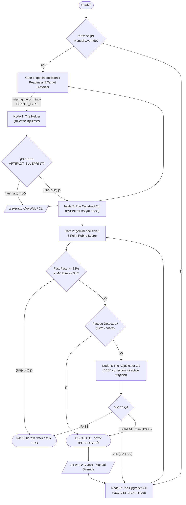

# 🧠 BetterBot 2.0 — Hybrid Agent & Skill Compiler (מפעל הבינה)

מערכת מולטי-סוכנים (Multi-Agent System) אוטונומית ודו-שלבית להנדסת פרומפטים, תכנון סוכני AI והידור חבילות **Agent Skills** ברמת Production, המבוססת על **LangGraph**, **FastAPI**, **SQLite (`storage.py`)**, ואינטגרציה היברידית של מודלי **Google Gemini (`gemini-4-hydrogen`, `gemini-4-argon`, ו-`gemini-decision-1`)**.

המערכת כוללת ממשק **Obsidian & Neural Glass Studio** מלא עם שידור חי (SSE), ספריית היסטוריית יצירות מתמידה, מעבדת תוצרים רב-קובצית (`SKILL.md` + `references/*` + ייצוא `.ZIP`), מד מוכנות וניקוד רובריקות כמותי (`gemini-decision-1`), ואת **בטי (Betty)** — עוזרת ויועצת ארכיטקטורה צפה ומעוגנת בזמן אמת.

> [!NOTE]
> **מדיניות ענפים וסביבת Live Production:**
> ענף `main` שמור כגרסת הייצור היציבה המחוברת לפריסה החיה ב-**Render** (המקושרת בקורות החיים). כל עבודת הפיתוח השוטפת, השיפורים והגרסאות החדשות מנוהלים ונדחפים לענף `develop` בלבד, ויימזגו ל-`main` רק לאחר ייצוב ובדיקה מקיפה כדי להבטיח זמינות וריצה חלקה של האתר שבאוויר.

---

## 🎯 המטרה ו-3 יעדי ההידור (Purpose & Compilation Targets)

מודלים מתקדמים בעלי חשיבה טבעית (Native Reasoning) כבר אינם זקוקים לפרומפטים עמוסים ומנופחים עם תגיות חשיבה גלויות. במקום לייצר "קיר טקסט" אחיד, **BetterBot 2.0** ממיר דרישה חופשית בעברית לאחד משלושה יעדי הידור ייעודיים תחת תבנית `<ARTIFACT_BLUEPRINT>`:

1. **`SKILL_PACKAGE` (`SKILL.md` + `references/*`):**
   * מפיק קובץ `SKILL.md` מודולרי עם **YAML Frontmatter** מדויק (`name`, `description` הכולל טריגרים חיוביים ושליליים) ונוהל ביצוע תמציתי (SOP).
   * מיישם **חשיפה הדרגתית (Progressive Disclosure)**: תבניות כבדות, סכמות ודוגמאות מופרדות אוטומטית לקובצי עזר תחת `references/<filename>.md`.
2. **`SYSTEM_PROMPT` (Constitutional System Prompt):**
   * מפיק פרומפט מערכת חוקתי בדחיסות טוקנים גבוהה, מונחה-פעולה (Affirmative Actionability) ונטול תגיות CoT גלויות מיותרות, המגובה ברובריקת אימות פנימית שקטה (`<VERIFICATION_RUBRIC>`).
3. **`HYBRID_BUNDLE` (`SYSTEM_PROMPT.md` + `SKILL.md` + `references/*`):**
   * מפיק חבילה משולבת הכוללת גם זהות ליבה חוקתית וגם סקיל מודולרי נפרד וקובצי עזר, הניתנת להורדה ישירה כארכיון `.zip`.

---

## 💡 הארכיטקטורה ההיברידית ומנוע ההחלטות (`gemini-decision-1`)

המערכת בנויה כגרף מצבים ציקלי (**StateGraph** ב-LangGraph) המשלב **מודל החלטות חד-מעברי (`gemini-decision-1` — 0 טוקני פלט)** כשני שערי בקרה כמותיים (**Gate 1 & Gate 2**) לצד מודלי היצירה והמהדר (`gemini-4-hydrogen` ו-`gemini-4-argon`):

### תרשים זרימת המערכת (BetterBot 2.0)



### שערי המנוע ההיברידי וארבעת הסוכנים

1. **Gate 1 — בדיקת מוכנות ראיון (`gemini-decision-1` + `HELPER_READINESS_QUESTIONS`):**
   * מעריך בכל תור שיחה 6 ממדים (`target_type`, `has_core_objective`, `has_trigger_or_context`, `has_output_contract`, `needs_auxiliary_files`, `ready_to_compile`) ומזריק ל-Helper רמז מדויק (`missing_fields_hint`).
2. **Node 1 — The Helper (`The Requirements Architect`):**
   * מראיין את המשתמש בעברית (עד 3 סבבים) בעקרון **Inference over Interrogation**, ומפיק תבנית `<ARTIFACT_BLUEPRINT>` הכוללת `<META>`, `<IDENTITY_AND_STANCE>`, `<ROUTING_AND_TRIGGERS>`, `<EXECUTION_ARCHITECTURE>` ו-`<OUTPUT_CONTRACT>` (תוך תמיכה מלאה לאחור ב-`<GEM_BLUEPRINT>`).
3. **Node 2 — The Construct 2.0 (`The Hybrid Compiler`):**
   * מופעל על ידי `COMPILER_MODEL` (`gemini-4-argon` עם Fallback אוטומטי ל-`gemini-4-hydrogen`) ומפצל אוטומטית בלוקי `### FILE: references/...` לתוך `state["reference_files"]`.
4. **Gate 2 & Node 4 — The Adjudicator 2.0 (`gemini-decision-1` + `ADJUDICATOR_RUBRIC_QUESTIONS`):**
   * **Stage A (דירוג כמותי ב-v1beta/decisions ב-~500ms):** מדרג 6 ממדים בסקאלת 0–5: `intent_alignment`, `token_density_no_bloat`, `trigger_precision`, `progressive_disclosure`, `actionable_clarity`, ו-`output_contract_strength` (פלוס `challenger_beats_champion` ברצפי רגרסיה).
   * **Stage B (Fast Pass / Plateau Breaker / Pinpoint Fail):** מאשר מיידית ללא קריאת LLM יצרנית כשהציון המשוקלל `>= 0.82` (וכל ממד `>= 3.0`), עוצר ב-`ESCALATE` בזיהוי קיפאון (עלייה `< 0.02`), או מפיק הוראות תיקון כירורגיות לממדים החלשים (מוגבל ל-`MAX_QA_ITERATIONS = 2`).
5. **Node 3 — The Upgrader 2.0 (`Atomic Synchronizer`):**
   * מעדכן אטומית גם את `<ARTIFACT_BLUEPRINT>` וגם את כל קובצי התוצר (`SKILL.md`, `SYSTEM_PROMPT.md`, ו-`references/*`) בעקבות כשלון QA או פקודת `[MANUAL OVERRIDE]`.

---

## 🖥️ ממשק ה-Studio, ספריית היסטוריה וייצוא חבילות (v3.3)

* **אחסון מתמיד ב-SQLite ([storage.py](file:///c:/Users/yubra/OneDrive/שולחן%20העבודה/BetterBot/storage.py)) ושחזור אוטומטי (`localStorage`):**
  * כל יצירה נשמרת אוטומטית במסד נתונים מתמיד (`betterbot_history.db`) וכוללת מיגרציה אוטומטית מקובץ `betterbot_sessions_snapshot.json` במידה וקיים.
  * הסשן הפעיל וחלון העבודה האחרון משוחזרים אוטומטית ברענון הדף.
* **כיול זמני חשיבה ומהירות (Thinking Budget & Low Latency):**
  * `FAST_MODEL` (`gemini-4-hydrogen`): מכויל עם `thinking_level="low"` לראיון מהיר (`The Helper`), בקרת איכות ובטי.
  * `COMPILER_MODEL` (`gemini-4-argon` / `gemini-4-hydrogen`): מכויל עם `thinking_level="medium"` להידור מהיר ומדויק ללא שיהוי מיותר.
  * שער ההחלטות `v1beta/decisions` רץ ב-~500ms בלבד עם 0 טוקני פלט ו-Timeout קשיח של 5 שניות.
* **ספריית היסטוריית יצירות (Creation History Library):**
  * פופאובר ייעודי בכותרת העליונה עם חיפוש חופשי, סינון לפי `SKILL_PACKAGE` / `SYSTEM_PROMPT` / `HYBRID_BUNDLE`, תגיות סטטוס וזמן עדכון יחסי, שינוי שם (`PATCH /api/sessions/{id}`) ומחיקה (`DELETE /api/sessions/{id}`).
* **סטודיו תוצרים רב-קובצי וייצוא `.ZIP` (`view-artifacts`):**
  * תגיות `target_type` ו-`slug_name`, בורר קבצים (`#artifactFileSwitcher`) למעבר בין הקובץ הראשי לקובצי `references/*`, כרטיסיות Bento עבור `<ARTIFACT_BLUEPRINT>`, וכפתור **"הורד חבילה (.ZIP)"** (`GET /api/sessions/{id}/download`) האורז את `SKILL.md` / `SYSTEM_PROMPT.md`, כל קובצי `references/*` ו-`blueprint.xml`.
* **Decision 1 Rubric Scorecard (`view-qa`) ומד מוכנות (`view-interview`):**
  * הצגה ויזואלית של 6 ממדי הרובריקה בסרגלי התקדמות (0–5), ציון משוקלל, אינדיקטור `Challenger > Champion` והשוואת Unified / Side-by-Side Diff.
* **בטי (Betty) — AI Advisor:**
  * פאנל צד דוחף (Push Side-Panel) או חלון צף דו-מצבי (`Tech Support` ו-`Prompt Advisor`) עם מודעות בזמן אמת ל-`target_type`, `reference_files` וציוני `gemini-decision-1`.

---

## 🚀 התקנה, פריסה ומשתני סביבה (Installation & Deployment)

### 1. התקנה והרצה מקומית
```powershell
git clone https://github.com/yubranvalde-byte/betterBot.git
cd betterBot

python -m venv venv
.\venv\Scripts\activate
.\venv\Scripts\pip.exe install -r requirements.txt
.\venv\Scripts\python.exe server.py
```
לאחר ההפעלה פתחו בדפדפן: 👉 **http://127.0.0.1:8000**

### 2. משתני סביבה (`.env` ו-`render.yaml`)
| משתנה | ברירת מחדל | תיאור |
| :--- | :--- | :--- |
| `GOOGLE_API_KEY` | *(חובה)* | מפתח API פעיל של Google AI Studio / Gemini |
| `FAST_MODEL` | `gemini-4-hydrogen` | המודל המהיר לראיון (`The Helper`), בקרת איכות ובטי |
| `COMPILER_MODEL` | `gemini-4-argon` | מודל המהדר והשדרוגים (`The Construct` / `The Upgrader`, עם Fallback ל-`FAST_MODEL`) |
| `DECISION_MODEL` | `gemini-decision-1` | מנוע ההחלטות החד-מעברי לשערי מוכנות ראיון ורובריקות QA |
| `DB_PATH` | `betterbot_history.db` | נתיב קובץ מסד הנתונים של SQLite לשמירת סשנים והיסטוריה |

---

## 📂 מבנה הקוד והפרויקט (Project Structure)

```text
BetterBot/
├── server.py            # שרת FastAPI: הזרמת SSE, הידרציית SQLite, CRUD לספריית יצירות וייצוא .ZIP
├── storage.py           # שכבת אחסון מתמידה ב-SQLite (init_db, save/load/list/rename/delete + מיגרציה)
├── main.py              # מנוע LangGraph 2.0, אינטגרציית gemini-decision-1, פיצול רב-קבצי ו-4 הסוכנים
├── prompts.py           # סכמות HELPER_READINESS_QUESTIONS / ADJUDICATOR_RUBRIC_QUESTIONS ופרומפטי 2.0 + בטי
├── static/              # ממשק ה-Web (Obsidian & Neural Glass Studio v3.3)
│   ├── index.html       # מעטפת 4 חלונות, ספריית היסטוריה, בורר קבצים וכרטיס ניקוד רובריקה
│   ├── styles.css       # עיצוב Obsidian Slate, כרטיסי Bento, Progress Bars ו-Push Panel
│   └── app.js           # שחזור localStorage, ניהול היסטוריית יצירות, SSE ומציג Diff
├── requirements.txt     # חבילות Python וגרסאות
├── render.yaml          # קובץ Blueprint לפריסה ב-Render כולל משתני המודלים וה-DB
├── .gitignore           # החרגת סביבה, סודות ומסדי נתונים מקומיים
└── README.md            # תיעוד הפרויקט
```
