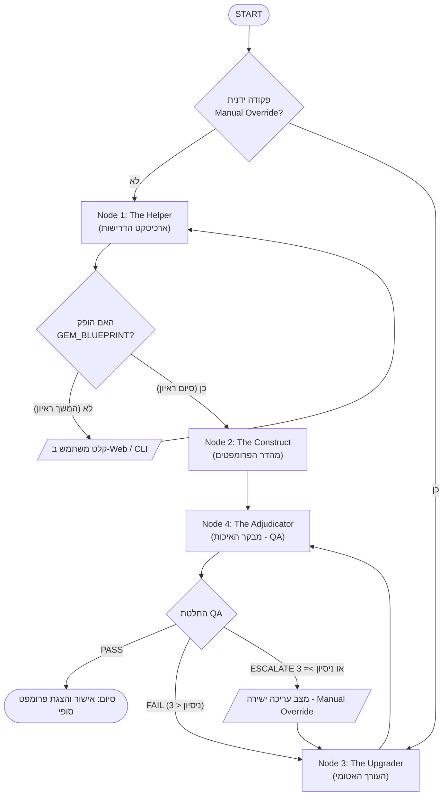

# 🧠 BetterBot — The Intelligence Factory (מפעל הבינה)

מערכת מולטי-סוכנים (Multi-Agent System) אוטונומית להנדסת פרומפטים וייצור סוכני AI ברמת Production, המבוססת על **LangGraph**, **FastAPI**, **LangChain** ו-**Google Gemini (`gemini-3.5-flash-lite`)**.

המערכת כוללת **ממשק Web גרפי מלא (Full-Stack Control Center)** עם שידור חי (SSE) של זרימת הסוכנים, סטודיו תוצרים ובקרת איכות, ואת **בטי (Betty)** — עוזרת ויועצת AI צפה דו-מצבית המלווה את המשתמש בזמן אמת.

> [!NOTE]
> **מדיניות ענפים וסביבת Live Production:**
> ענף `main` שמור כגרסת הייצור היציבה המחוברת לפריסה החיה ב-**Render** (המקושרת בקורות החיים). כל עבודת הפיתוח השוטפת, השיפורים והגרסאות החדשות מנוהלים ונדחפים לענף `develop` בלבד, ויימזגו ל-`main` רק לאחר ייצוב ובדיקה מקיפה כדי להבטיח זמינות וריצה חלקה של האתר שבאוויר.

---

## 🎯 המטרה (Purpose)

כתיבת פרומפט מערכת (System Prompt) איכותי, עמיד ונטול הזיות דורשת היכרות מעמיקה עם טכניקות הנדסת פרומפטים מתקדמות (כגון Chain of Thought, Chain of Verification, Step-Back Prompting, ReAct, Output Fortification ועוד).

**BetterBot** פותר את הפער הזה מקצה לקצה:
1. מקבל מהמשתמש תיאור חופשי בשפה טבעית (בעברית) של הבוט שהוא חולם לבנות.
2. מראיין אותו בקצרה כמו מנהל מוצר וארכיטקט מערכות מנוסה.
3. מתרגם את הדרישות לארכיטקטורה קוגניטיבית מובנית ב-XML (`<GEM_BLUEPRINT>`).
4. מהדר אותה לפרומפט מערכת הנדסי שלם באנגלית.
5. מעביר את התוצר סדרת בדיקות איכות ותיקונים עצמיים אוטונומיים (Hill Climbing / Self-Correction) עד לאישור סופי (`PASS`) או התערבות ידנית מבוקרת (`ESCALATE`).

---

## 💡 הרעיון והארכיטקטורה (Core Concept & Architecture)

המערכת בנויה כגרף מצבים ציקלי (**StateGraph** ב-LangGraph) המנהל ארבעה סוכני AI מתמחים שפועלים יחד במודל **Champion vs. Challenger (Hill Climbing)** עם מנגנון הגנה מובנה (**Circuit Breaker**).

### תרשים זרימת המערכת



### ארבעת הסוכנים בגרף הליבה

1. **Node 1 — The Helper (`The Requirements Architect`):**
   * **תפקיד:** מראיין את המשתמש בעברית (עד 3–4 סבבי שאלות ממוקדות) כדי לחלץ את המטרה, הפרסונה, סגנון הדיבור, תהליך העבודה והשגיאות שיש להימנע מהן.
   * **היגיון פנימי:** מנהל בלוק חשיבה סמוי (`<thought_process>`) באנגלית, מסיק מסקנות באופן עצמאי (Inference over Interrogation), וממפה את צרכי המשתמש ל**ארסנל הקוגניטיבי**:
     `Chain of Thought (CoT)`, `The Reviewer (CoVe)`, `The Interviewer`, `Skeleton-of-Thought`, `Step-Back Logic`, `ReAct Framework`, `Sentiment Parsing`.
   * **פלט:** תבנית ארכיטקטונית מובנית תחת התגית `<GEM_BLUEPRINT>`.

2. **Node 2 — The Construct (`The Compiler`):**
   * **תפקיד:** מקבל את ה-`<GEM_BLUEPRINT>` ומהדר אותו לפרומפט מערכת שלם ומקצועי באנגלית.
   * **הגנות מובנות:** מבצע בדיקת אימות עצמית (`<compilation_check>`) לפני הפקת הפלט, אוכף סדר פעולות כרונולוגי בין מודולים קוגניטיביים (Hybrid Sequencing), ומחייב **Output Fortification** (4 גרשיים הפוכים ```` למניעת זליגת בלוקים של Markdown).

3. **Node 3 — The Upgrader (`AI System Editor`):**
   * **תפקיד:** נכנס לפעולה כאשר מבקר האיכות פוסל את הפרומפט או כאשר המשתמש מזין הוראת שדרוג ישירה (`[MANUAL OVERRIDE]`).
   * **עבודה מובנית:** משתמש ב-Pydantic Structured Output (`UpgraderOutput`) לניתוח השפעה ועדכון אטומי ומסונכרן של ה-XML והפרומפט גם יחד.

4. **Node 4 — The Adjudicator (`Senior QA Architect`):**
   * **תפקיד:** שומר הסף של המפעל. משתמש ב-Structured Output (`AdjudicatorDecision`) ופועל בשני מצבים:
     * **Baseline QA (איטרציה 0):** בודק את הפרומפט הראשוני מול כוונת המשתמש והבלופרינט.
     * **Regression QA (איטרציה 1+):** משווה את הגרסה החדשה (`Challenger`) מול הגרסה הטובה ביותר עד כה (`Champion`), מוודא שהליקויים תוקנו ולא נוצרה רגרסיה.
   * **Circuit Breaker (מפסק פחת):** אם אחרי 3 איטרציות של תיקון אוטומטי הפרומפט עדיין לא עובר (`FAIL`), המערכת עוצרת ומעבירה את השליטה למשתמש (`ESCALATE`).

---

## 🖥️ ממשק ה-Web והעוזרת האישית "בטי" (Multi-Window Studio Architecture v3.0)

הממשק בנוי בארכיטקטורת **Multi-Window Studio** מרווחת בגווני **Neutral Zinc Matte** (`#09090B` / `#121215` / `#18181C`) בהשראת **Linear**, **Cursor** ו-**Raycast** — ללא עומס של מסך מפוצל צפוף, עם סרגל ניווט צדדי קבוע (**Navigation Rail**), גלולת טלמטריה חיה בכותרת העליונה, ו-4 חלונות עבודה ייעודיים בגובה מלא (`100%` Viewport Height).

### 1. מעטפת הסטודיו ו-4 חלונות העבודה הייעודיים (`studio-view`)
* **סרגל כותרת עליון (`56px` Top Studio Bar):**
  * **גלולת טלמטריה אינטראקטיבית במרכז (`#headerTelemetryPill`):** מציגה בזמן אמת (SSE) את הסוכן הפעיל, תגית השלב ומד ה-**Circuit Breaker** (`0/3` עד `3/3`). לחיצה עליה מעבירה מיד לחלון מפת הסוכנים והטלמטריה.
  * **בקרת סשנים וכפתור בטי:** בחירת סשן ב-RAM, פתיחת `+ סוכן חדש`, וכפתור הפעלה נקי לסרגל הצד של **בטי (`AI Advisor`)**.
* **סרגל ניווט ראשי קבוע (`220px` Primary Navigation Rail):** מאפשר מעבר מהיר בין 4 חלונות עבודה מלאים עם מונים וחיוויי סטטוס חיים:
  1. **`view-interview` — זירת האפיון והראיון (Spacious Centered Chat Studio):**
     * עמודת שיחה מרוכזת (`max-width: 860px`) המעניקה להיסטוריית ההודעות (`#chatMessages`) כמעט 100% מגובה המסך.
     * **תבניות התחלה מהירה (`#presetsContainer`):** משולבות בתוך אזור הגלילה של הצ'אט כמסך פתיחה ונעלמות אוטומטית ברגע שליחת ההודעה הראשונה.
     * **מגירת חשיבה סמויה (`<thought_process>`)** ומצב **Manual Override** אוטומטי לעריכה ישירה.
  2. **`view-artifacts` — מעבדת הפרומפט וה-XML (Full-Height IDE Studio):**
     * בורר WAI-ARIA אחוד בין **פרומפט המערכת** (רינדור Markdown מובנה או קוד גולמי, מד תווים וטוקנים, שלד טעינה דינמי Shimmer Skeleton, חשיפת `<compilation_check>`, העתקה והורדת `.MD`) לבין **XML Blueprint** (כרטיסיות מודולים + קוד XML מלא).
     * **שורת פקודה מהירה ל-Upgrader (`#artifactUpgraderForm`):** מעוגנת בתחתית מעבדת התוצרים ומאפשרת לשלוח הוראות שדרוג אטומיות ל-`The Upgrader` בזמן צפייה בפרומפט מבלי לחזור לחלון הצ'אט.
  3. **`view-qa` — מעבדת בקרת איכות ו-Diff ברוחב מלא:**
     * רצועת החלטות ה-`Adjudicator` (`#qaLogsList`) ומציג **Champion מול Challenger** ברוחב 100% עם מתג מעבר בין **Unified Diff** (סימון שורות `+` בירוק ו-`-` באדום) לבין **Side-by-Side**.
  4. **`view-pipeline` — מפת הסוכנים וטלמטריה חיה:**
     * דיאגרמת ארכיטקטורה אינטראקטיבית של 4 הסוכנים (`The Helper`, `The Construct`, `The Adjudicator`, `The Upgrader`) שבה לחיצה על כל צומת מנווטת ישירות לחלון העבודה שלו, לצד **יומן ריצה חי** (`#timelineList`) הכולל סינון וחיפוש מיידי (`#timelineSearchInput`).

### 2. בטי (Betty) — פאנל צד דוחף (Non-Overlapping Push Side-Panel) וחלון צף
* **Push Side-Panel במצב עגינה (`380px` Docked Mode — ברירת מחדל):** כאשר פותחים את בטי מכפתור הכותרת, היא נפתחת כפאנל צד בתוך פריסת ה-Flex של הסטודיו — כך שהיא **לעולם אינה מסתירה או עולה על תוכן החלונות**. ניתן לעבור למצב חלון צף נגרר או מסך מוגדל באמצעות `#bettyDockBtn` ו-`#bettyMaximizeBtn`.
* **מודעות מלאה להקשר הסשן (`<current_session_context>`):** בטי קוראת בזמן אמת את מצב הסשן הפעיל שלך (שלב נוכחי, ה-XML Blueprint, הפרומפט הנוכחי ויומן השגיאות של ה-QA).
* **בורר מצבים אחוד (Segmented Control):**
  1. **תמיכה טכנית והדרכה (`tech_support`):** מומחית לאפליקציית BetterBot — מסבירה איך המערכת עובדת, מה קורה בכל שלב בגרף, ואיך לתפעל כל כלי ומצב בממשק.
  2. **Prompt Advisor (`prompt_advisor`):** מבוססת על **The Master Prompt Architect & Mentor (Ultimate V5)**. מבצעת ניתוח **Tree of Thoughts (ToT)** ו-**Chain of Verification (CoVe)** בתוך `<thought_process>`, ומייצרת תשובות עומק מובנות הכוללות **ייעוץ וביקורת**, **טבלת השוואת חלופות (Trade-off Matrix)**, **הסבר מונחים** ו**שאלות מנחות**.

---

## 🚀 התקנה ודרך השימוש (Installation & Usage)

### 1. דרישות קדם
* **Python 3.11+**
* מפתח API פעיל של **Google AI Studio (Gemini API)**

### 2. הגדרת הסביבה והתלויות
שכפלו את המאגר והתקינו את התלויות מתוך `requirements.txt`:

```powershell
git clone https://github.com/yubranvalde-byte/betterBot.git
cd betterBot

# יצירת סביבה וירטואלית והפעלתה
python -m venv venv
.\venv\Scripts\activate

# התקנת כלל החבילות (LangGraph, LangChain, FastAPI, Uvicorn, Pydantic וכו')
.\venv\Scripts\pip.exe install -r requirements.txt
```

### 3. הגדרת משתני סביבה
צרו קובץ `.env` בתיקיית השורש של הפרויקט והגדירו בו את מפתח ה-API שלכם:

```env
GOOGLE_API_KEY=your_actual_google_api_key_here
```

### 4. הפעלת אפליקציית ה-Web (מומלץ)
הריצו את שרת ה-FastAPI:

```powershell
.\venv\Scripts\python.exe server.py
```

לאחר ההפעלה, פתחו בדפדפן את הכתובת:
👉 **http://127.0.0.1:8000**

*(לחלופין, ניתן להריץ את המערכת גם במצב טרמינל CLI קלאסי באמצעות `.\venv\Scripts\python.exe main.py`).*

### 5. פריסה לענן ועמידות סשנים (Cloud Deployment & Session Resilience via Render)
הפרויקט מותאם במלואו להעלאה כ-**Web Service** ב-[Render](https://render.com) (כולל קובץ Blueprint מובנה `render.yaml` עם `healthCheckPath: /api/health`):
* **התאוששות סשנים אוטומטית (Zero-404 Session Auto-Recovery & Snapshot Persistence):**
  * השרת שומר גיבוי אוטומטי של כלל הסשנים הפעילים לקובץ Snapshot מקומי (`betterbot_sessions_snapshot.json`) וטוען אותו בעת עליית השרת.
  * במידה וקונטיינר ה-Free Tier של Render נכבה לאחר חוסר פעילות או מופעל מחדש בעוד לשונית הדפדפן של המשתמש פתוחה עם `session_id` קודם, השרת משחזר או יוצר אוטומטית את הסשן המבוקש בזמן אמת (ב-`POST /api/sessions/{session_id}/stream` וב-`GET /api/sessions/{session_id}`) במקום להחזיר שגיאת `404 Not Found`.
* **תמיכה בבדיקות תקינות (`HEAD` & `GET`) ו-Keep-Alive:**
  * נתיבי `/` ו-`/api/health` תומכים בבקשות `GET` ו-`HEAD` עבור ה-Load Balancer של Render (ללא שגיאות `405 Method Not Allowed`).
  * ה-Frontend שולח פעימת Keep-Alive שקטה ל-`/api/health` כל 4 דקות כל עוד הלשונית פתוחה, ומוסיף כותרות `Cache-Control: no-cache, no-store, must-revalidate` לקבצים הסטטיים להבטחת טעינה מיידית של עדכוני ממשק (`v3.1`).
* **Build Command:**
  ```bash
  pip install -r requirements.txt
  ```
* **Start Command:**
  ```bash
  uvicorn server:app --host 0.0.0.0 --port $PORT
  ```
* **Environment Variables (בלוח הבקרה של Render):**
  * `GOOGLE_API_KEY`: מפתח ה-API של Google Gemini.
  * `PYTHON_VERSION`: `3.11.9`

---

## 📂 מבנה הקוד והפרויקט (Project Structure)

```text
BetterBot/
├── server.py            # שרת ה-FastAPI: ניהול סשנים ב-RAM, הזרמת SSE לגרף, ונקודות הקצה של בטי
├── main.py              # מנוע ה-LangGraph, הגדרות ה-FactoryState, ארבעת הצמתים, הניתובים ומעטפת ה-CLI
├── prompts.py           # פרומפטי המערכת של 4 סוכני הגרף + 2 פרומפטי המערכת של בטי (תמיכה ויועצת V5)
├── static/              # קבצי ה-Frontend של אפליקציית ה-Web (v3.0 Multi-Window Studio)
│   ├── index.html       # מעטפת Multi-Window Studio, סרגל ניווט, 4 חלונות עבודה ופאנל הצד של בטי
│   ├── styles.css       # עיצוב Neutral Zinc Matte (#09090B), פריסת חלונות בגובה מלא ו-Push Panel
│   └── app.js           # ניתוב חלונות (switchWorkspaceView), הזרמת SSE, מנוע Unified Diff ובטי
├── requirements.txt     # רשימת כל חבילות ה-Python והגרסאות המדויקות שלהן (UTF-8 נקי)
├── render.yaml          # קובץ תצורה (Blueprint) לפריסה אוטומטית ב-Render
├── fronter.txt          # מסמך האפיון המקורי למעבר מ-CLI ל-Client-Server
├── .env                 # משתני סביבה (GOOGLE_API_KEY) - מוחרג מ-Git
├── .gitignore           # הגדרות קבצים ותיקיות מוחרגים מבקרת גרסאות
└── README.md            # תיעוד הפרויקט המלא
```
