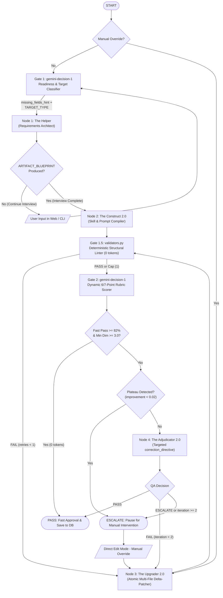

# 🧠 BetterBot 2.0 — Hybrid Agent & Skill Compiler

An autonomous, two-stage Multi-Agent System for prompt engineering, AI agent design, and production-grade **Agent Skills** compilation, built on **LangGraph**, **FastAPI**, a dual-engine persistence layer (**Neon PostgreSQL + SQLite fallback** in `storage.py`), a **Vite + React + TypeScript** UI (`frontend/`), and tiered hybrid integration of **Google Gemini** models (`gemini-4-neon`, `gemini-4-hydrogen`, and `gemini-decision-1`).

The system features the **Obsidian & Neural Glass Studio (v3.6)** interface with live SSE streaming, workspace isolation, **Workspace Sync (`Master Mode`)** + one-click JSON import/export, a persistent creation history drawer, a hierarchical multi-file artifact studio (`SKILL.md`, `AGENTS.md`, `references/*`, Python stdlib helper scripts under `scripts/*.py`, `skills/<sub_slug>/SKILL.md`, and `.ZIP` export including `BETTERBOT_INSTALL.md`), a readiness meter and dynamic 6/7-dimension rubric scorecard (`gemini-decision-1`), and **Betty** — a docked/floating real-time architecture advisor aware of `SKILL_SUITE` topology.

> [!NOTE]
> **Branch & Live Production Policy:**
> The `main` branch is reserved as the stable production release connected to the live **Render** deployment. All active development, improvements, and new versions are managed and pushed exclusively on `develop`, and merged into `main` only after stabilization and thorough verification to ensure high availability of the live site.

---

## 🎯 Purpose & 4 Compilation Targets

Modern models with native reasoning no longer need bloated prompts cluttered with explicit thinking tags. Instead of generating a monolithic "wall of text," **BetterBot 2.0** compiles free-form requirements into one of four dedicated compilation targets under an `<ARTIFACT_BLUEPRINT>`:

1. **`SKILL_PACKAGE` (`SKILL.md` + `references/*` + optional `scripts/*.py`):**
   * Produces a modular `SKILL.md` with precise **YAML Frontmatter** (`name`, `description` including positive and negative triggers) and a concise Standard Operating Procedure (SOP).
   * Enforces **Progressive Disclosure**: heavy templates, schemas, and examples are automatically separated into auxiliary files under `references/<filename>.md`, and deterministic mechanical tasks (`needs_scripts=True`) are offloaded to standalone **Python 3 stdlib-only** CLI scripts under `scripts/<name>.py`.
2. **`SYSTEM_PROMPT` (Constitutional System Prompt / `AGENTS.md`):**
   * Produces a token-dense constitutional system prompt driven by Affirmative Actionability without unnecessary visible CoT tags, backed by a silent internal `<VERIFICATION_RUBRIC>`. In **`is_repo_context=True`** mode (an operational contract for repository coding agents), the output is exported directly as a repo-focused **`AGENTS.md`** (Git/Branch Guardrails, Directory-as-Router table, invariants, and verification protocol) without adding a 5th target type and without `scripts/*.py`.
3. **`HYBRID_BUNDLE` (`SYSTEM_PROMPT.md` / `AGENTS.md` + `SKILL.md` + `references/*` + optional `scripts/*.py`):**
   * Produces a combined package containing both a core constitutional identity (or `AGENTS.md` in repo mode) and a separate modular skill with auxiliary files/scripts, packaged for direct download as a `.zip` archive under `<slug_name>/` alongside `BETTERBOT_INSTALL.md`.
4. **`SKILL_SUITE` (`skills/<sub_slug>/SKILL.md` + `skills/<sub_slug>/references/*` + optional `skills/<sub_slug>/scripts/*.py`):**
   * Compiles a multi-skill suite of 2–4 independently installable atomic skills (Pick & Mix) in a nested directory tree under `skills/<sub_slug>/...`, with hierarchical `.zip` export under `<slug_name>/` and `BETTERBOT_INSTALL.md`.
   * Governed by the **Orthogonality Rule** in Gate 1: the system defaults to a single skill (`SKILL_PACKAGE` or `HYBRID_BUNDLE` + `references/*`) for tightly coupled workflows, and activates `SKILL_SUITE` only for 2–4 distinct domains while enforcing mutual negative triggers in each sibling skill's `description` to prevent trigger collisions.

---

## 💡 Hybrid Architecture & Decision Engine (`gemini-decision-1`)

The system is built as a cyclic **StateGraph** in LangGraph combining a **single-pass decision model (`gemini-decision-1` — 0 output tokens)** as two quantitative control gates (**Gate 1 & Gate 2**) alongside tiered model routing between **`gemini-4-neon`** (for compilation, atomic upgrading, and quality adjudication) and **`gemini-4-hydrogen`** (for interviewing, Betty, and fallback):

### System Flow Diagram (BetterBot 2.0)



### Hybrid Engine Gates & Four Agents

1. **Gate 1 — Interview Readiness & Orthogonality Rule (`gemini-decision-1` + `HELPER_READINESS_QUESTIONS`):**
   * Evaluates 8 fields on every conversation turn (`target_type` from 4 valid values: `SKILL_PACKAGE`, `SYSTEM_PROMPT`, `HYBRID_BUNDLE`, `SKILL_SUITE`; plus `has_core_objective`, `has_trigger_or_context`, `has_output_contract`, `needs_auxiliary_files`, `needs_scripts`, `is_repo_context`, `ready_to_compile`), enforces the **Orthogonality Rule** to prevent over-splitting tightly coupled workflows, and injects a targeted `missing_fields_hint` into the Helper.
2. **Node 1 — The Helper (`The Requirements Architect`):**
   * Interviews the user (up to 3 turns) using **Inference over Interrogation**, focuses `is_repo_context=True` sessions on repository topology and verification constraints rather than a chatbot persona, and produces an `<ARTIFACT_BLUEPRINT>` containing `<META>`, `<IDENTITY_AND_STANCE>`, `<ROUTING_AND_TRIGGERS>`, `<EXECUTION_ARCHITECTURE>`, and `<OUTPUT_CONTRACT>` (with full backward compatibility for `<GEM_BLUEPRINT>`). When `target_type == "SKILL_SUITE"`, the blueprint also includes `<SUITE_TOPOLOGY>` defining 2–4 atomic skills (`slug`, `single_responsibility`, `positive_triggers`, and `negative_triggers_vs_siblings`).
3. **Node 2 — The Construct 2.0 (`The Hybrid Compiler`):**
   * Powered by `COMPILER_MODEL` (`gemini-4-neon` with automatic fallback to `FALLBACK_MODEL` / `gemini-4-hydrogen`), using `thinking_level="medium"` for multi-file packages (`SKILL_PACKAGE` / `HYBRID_BUNDLE` / `SKILL_SUITE` / `references/` / `scripts/`) and `thinking_level="low"` for lightweight `SYSTEM_PROMPT` targets. Splits nested `### FILE: <path>` blocks (such as `references/...`, `scripts/<name>.py`, `AGENTS.md`, `skills/<sub_slug>/SKILL.md`, `skills/<sub_slug>/references/<file>.md`, and `skills/<sub_slug>/scripts/<name>.py`) through strict path sanitization (`normalize_artifact_path` rejecting empty paths, absolute paths, or `..` segments) and defensive stripping of outer Markdown code fences from `.py` files (`_strip_python_code_fence`) into the unified `state["reference_files"]` map.
4. **Gate 1.5 — Deterministic Structural Linter (`validators.py` — `gate_1_5_linter`, 0 tokens):**
   * Runs automatically after `The Construct 2.0` and `The Upgrader 2.0` and before Gate 2 (`gemini-decision-1`) to catch objective structural failures with zero LLM calls: YAML Frontmatter validity (`name`, `description`), deterministic Python syntax validation via `ast.parse()` on all `scripts/*.py` (`skills/<sub_slug>/scripts/*.py`), prohibition of scripts in `SYSTEM_PROMPT`, broken `references/*` / `scripts/*` links or orphan files (including relative path resolution under `skills/<sub_slug>/...` in `SKILL_SUITE`), 2–4 skill topology in `SKILL_SUITE`, `AGENTS.md` entry-point recognition, and path safety (`normalize_artifact_path`). Capped at `MAX_LINTER_RETRIES = 1` via `linter_retries` without consuming the Gate 2 QA budget (`MAX_QA_ITERATIONS = 2`).
5. **Gate 2 & Node 4 — The Adjudicator 2.0 (`gemini-decision-1` + `get_rubric_questions`):**
   * **Stage A (Dynamic Quantitative Scoring via `v1beta/decisions` in ~500ms):** Driven by `get_rubric_questions(target_type)` — preserves the 6 standard dimensions (`intent_alignment`, `token_density_no_bloat`, `trigger_precision`, `progressive_disclosure`, `actionable_clarity`, and `output_contract_strength`) for `SYSTEM_PROMPT`, `SKILL_PACKAGE`, and `HYBRID_BUNDLE`, and dynamically appends a 7th dimension `trigger_deconfliction` (0–5) for `SKILL_SUITE` only — passing full `reference_files` content for evaluation, persistently anchoring all `[MANUAL OVERRIDE]` directives in `effective_user_input`, and evaluating `challenger_beats_champion` against the previous Champion.
   * **Stage B (Fast Pass / Manual Override Calibration / Plateau Breaker):** Immediately approves without a generative LLM call when `weighted_avg >= 0.82` (and every dimension `>= 3.0`), or after a manual override (`post_override_pass` when `min_dim_score >= 3.0` and `weighted_avg >= 0.82` or `beats_champ >= 0.5`, promoting to Champion and bypassing the post-override Plateau Breaker); guards against monoliths with a deterministic cap (`progressive_disclosure <= 2.0` + `FAIL` when `references/*` are required but missing) alongside calibrated scoring for compact single-file skills (`<5KB` when `needs_auxiliary_files=False`); halts with `ESCALATE` on plateau detection (improvement `< 0.02`), or generates a targeted `correction_directive` via `ADJUDICATOR_MODEL` (`gemini-4-neon`, `thinking_level="low"`, falling back to `gemini-4-hydrogen`) — capped at `MAX_QA_ITERATIONS = 2`.
6. **Node 3 — The Upgrader 2.0 (`Atomic Delta-Patcher`):**
   * Powered by `UPGRADER_MODEL` (`gemini-4-neon`, `thinking_level="medium"`, falling back to `gemini-4-hydrogen`) and operates via **Delta-Patching** instead of full rewrites: emits only added/modified `### FILE: <path>` blocks (including `scripts/*.py` and `AGENTS.md`) and optional `### DELETE: <path>` directives, merges changes into `state["reference_files"]` while leaving untouched files intact, and atomically synchronizes `<ARTIFACT_BLUEPRINT>` and core files following a QA failure or `[MANUAL OVERRIDE]` command.

---

## 🖥️ Studio UI, Dual-Engine Persistence & Package Export (v3.6)

* **Dual-Engine Persistent Storage — Neon PostgreSQL + SQLite Fallback ([storage.py](storage.py)):**
  * Built-in support for **Neon PostgreSQL** in production (`DATABASE_URL` via `psycopg` v3) with zero-config fallback to local **SQLite** (`betterbot_history.db`) through the unified `_ConnAdapter`.
  * Includes sanitized hydration of nested `reference_files` paths and `needs_scripts` / `is_repo_context` flags, idempotent migrations scoped by `owner_id`, and automatic restoration from `betterbot_sessions_snapshot.json` if present.
  * The active session and last workspace view are automatically restored on page refresh via `localStorage`.
* **Multi-Tenant Workspace Isolation, `Master Mode` & JSON Portability:**
  * Each browser is automatically isolated under a UUID (`betterbot_workspace_id`) sent via the `X-Workspace-ID` header, segregating data by `owner_id` in PostgreSQL/SQLite, in-memory cache (`SESSIONS`), and Betty's history.
  * The **"Workspace Sync"** modal (`WorkspaceSyncModal`) and optional **`Master Mode`** (`MASTER_WORKSPACE_KEY` via `X-Master-Key` header and `POST /api/workspace/verify-master`) allow the owner to access central history from any browser without a login wall.
  * One-click **JSON Export / Import** (`GET /api/workspace/export` and `POST /api/workspace/import`) provides portable backup and restore with idempotent upsert and ID remapping on cross-workspace collisions.
* **Thinking Budget Calibration, Tiered Routing & Fallback:**
  * `FAST_MODEL` (`gemini-4-hydrogen`, `thinking_level="low"`): powers `The Helper`, `Betty`, and serves as the deterministic `FALLBACK_MODEL`.
  * `COMPILER_MODEL` (`gemini-4-neon`): powers `The Construct 2.0` (`thinking_level="medium"` for `SKILL_PACKAGE`, `HYBRID_BUNDLE`, `SKILL_SUITE`, `references/`, or `scripts/`, and `low` for lightweight `SYSTEM_PROMPT`), `The Upgrader 2.0` (`thinking_level="medium"`), and Stage B of `The Adjudicator 2.0` (`thinking_level="low"`), with automatic fallback to `FALLBACK_MODEL` / `gemini-4-hydrogen`.
  * The `v1beta/decisions` gate (`gemini-decision-1`) runs in ~500ms with 0 output tokens and a 5-second hard timeout.
* **Creation History Drawer (`HistoryDrawer`):**
  * Sidebar drawer with free-text search, filtering by `SKILL_PACKAGE` / `SYSTEM_PROMPT` / `HYBRID_BUNDLE` / `SKILL_SUITE` (`SUITE`), distinct status badges, active-file reset on session switch, rename (`PATCH /api/sessions/{id}`), delete (`DELETE /api/sessions/{id}`), and JSON export/import.
* **Hierarchical Artifact Studio & `.ZIP` Export (`ArtifactsView`):**
  * Smart file explorer (`buildArtifactTree`): groups folder trees per `<sub_slug>` for `SKILL_SUITE` (auto-selecting the first `SKILL.md` when the primary prompt is empty), displays and sorts `AGENTS.md`, `SKILL.md`, `references/*`, and `scripts/*.py`, alongside Bento cards for `<ARTIFACT_BLUEPRINT>`.
  * **"Download Package (.ZIP)"** (`GET /api/sessions/{id}/download`) packages everything under a clean `<slug_name>/` root (including `AGENTS.md` in `is_repo_context` mode, `scripts/*.py`, and `blueprint.xml`) together with a deterministic **`<slug_name>/BETTERBOT_INSTALL.md`** guide (0 LLM calls, "Do No Harm" — including merge warnings before overwriting `AGENTS.md`/`CLAUDE.md`/`GEMINI.md`, documentation of Python 3 stdlib-only scripts requiring no `pip install`, and exclusion of `blueprint.xml` from runtime directories).
* **Decision 1 Rubric Scorecard (`QaView`) & Readiness Meter (`InterviewView`):**
  * Displays 6 rubric dimensions with `PrismBar` (0–5), dynamically appending the 7th dimension `trigger_deconfliction` (**Trigger De-confliction**) for `SKILL_SUITE` sessions only, alongside weighted score, `Challenger > Champion` indicator, and Unified / Side-by-Side Diff viewer.
* **Betty — AI Advisor:**
  * Dual-mode side panel (`Tech Support` and `Prompt Advisor`) with workspace-isolated (`owner_id`) history/cache and full live context including `target_type`, `skills/<sub_slug>/...` file tree and mutual triggers, `gemini-decision-1` scores (including `trigger_deconfliction`), and installation guidance via `BETTERBOT_INSTALL.md`.

---

## 🚀 Installation, Deployment & Environment Variables

### 1. Local Installation & Startup
```powershell
git clone https://github.com/yubranvalde-byte/betterBot.git
cd betterBot

python -m venv venv
.\venv\Scripts\activate
.\venv\Scripts\pip.exe install -r requirements.txt
.\venv\Scripts\python.exe server.py
```
Once running, open in your browser: 👉 **http://127.0.0.1:8000**

### 2. Environment Variables (`.env` and `render.yaml`)
| Variable | Default | Description |
| :--- | :--- | :--- |
| `GOOGLE_API_KEY` | *(Required)* | Active Google AI Studio / Gemini API key |
| `FAST_MODEL` | `gemini-4-hydrogen` | Fast model (`thinking_level="low"`) for interviewing (`The Helper`), `Betty`, and Fallback |
| `COMPILER_MODEL` | `gemini-4-neon` | Core model (`The Construct 2.0` at `medium`/`low`, `The Upgrader 2.0` at `medium`, and `The Adjudicator 2.0` at `low`) |
| `FALLBACK_MODEL` | `gemini-4-hydrogen` | Deterministic fallback target when `COMPILER_MODEL` fails or is unavailable |
| `DECISION_MODEL` | `gemini-decision-1` | Single-pass decision engine for interview readiness and QA rubric gates (Gate 1 & Gate 2) |
| `HELPER_MODEL` / `CONSTRUCT_MODEL` / `UPGRADER_MODEL` / `ADJUDICATOR_MODEL` / `BETTY_MODEL` | *(Optional — role defaults)* | Explicit per-agent or per-role model override |
| `DATABASE_URL` | *(Optional — falls back to SQLite via `DB_PATH`)* | Connection string for **Neon PostgreSQL** in production (via `psycopg` v3; falls back automatically to local SQLite if unset) |
| `DB_PATH` | `betterbot_history.db` | SQLite database file path for local session and history persistence (Fallback) |
| `MASTER_WORKSPACE_KEY` | *(Optional)* | Secret key to enable `Master Mode` and secure access to central owner history on shared/Render deployments (constant-time verification via `X-Master-Key` header) |

---

## 📂 Project Structure

```text
BetterBot/
├── server.py                  # FastAPI server: SSE streaming, workspace isolation (X-Workspace-ID / X-Master-Key), JSON import/export, CRUD, hierarchical .ZIP export (incl. AGENTS.md & scripts/*.py) + BETTERBOT_INSTALL.md, and live Betty context
├── storage.py                 # Dual-engine persistence scoped by owner_id: Neon PostgreSQL (DATABASE_URL / psycopg v3) + SQLite Fallback, idempotent migrations, and hydration of reference_files & state flags
├── main.py                    # LangGraph 2.0 engine, gemini-decision-1 (Gate 1/2), Gate 1.5, stdlib scripts (needs_scripts), AGENTS.md mode (is_repo_context), SKILL_SUITE support, Delta-Patching, and Manual Override calibration
├── validators.py              # Zero-token Gate 1.5 deterministic structural linter (YAML frontmatter, ast.parse() on scripts/*.py, references, SKILL_SUITE topology, AGENTS.md) and normalize_artifact_path
├── prompts.py                 # Thin stdlib loader + dynamic rubrics (HELPER_READINESS_QUESTIONS incl. needs_scripts & is_repo_context, get_rubric_questions with trigger_deconfliction)
├── prompts/                   # Externalized per-agent Markdown templates (helper, construct, upgrader, adjudicator_baseline, adjudicator_regression, betty_*)
├── frontend/                  # Studio app in Vite + React + TypeScript + Tailwind (src/api/client.ts, components/, utils/, types/) built directly into static/
├── static/                    # Vite-compiled production bundle (index.html, favicon.svg, assets/*) — do not hand-edit
├── scripts/
│   └── check_invariants.py    # Zero-dependency, zero-LLM architectural verification gate (branch, path sanitization, rubrics, files, and linter)
├── AGENTS.md                  # Operational contract, architecture map, and verification rules for coding agents
├── requirements.txt           # Python packages and pinned versions
├── render.yaml                # Render deployment blueprint including model and DB environment variables
├── .gitignore                 # Excludes venv, secrets, and local databases
└── README.md                  # Project documentation
```
